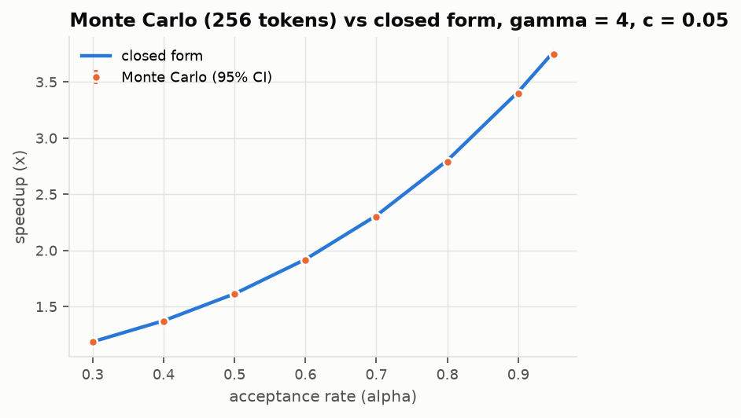
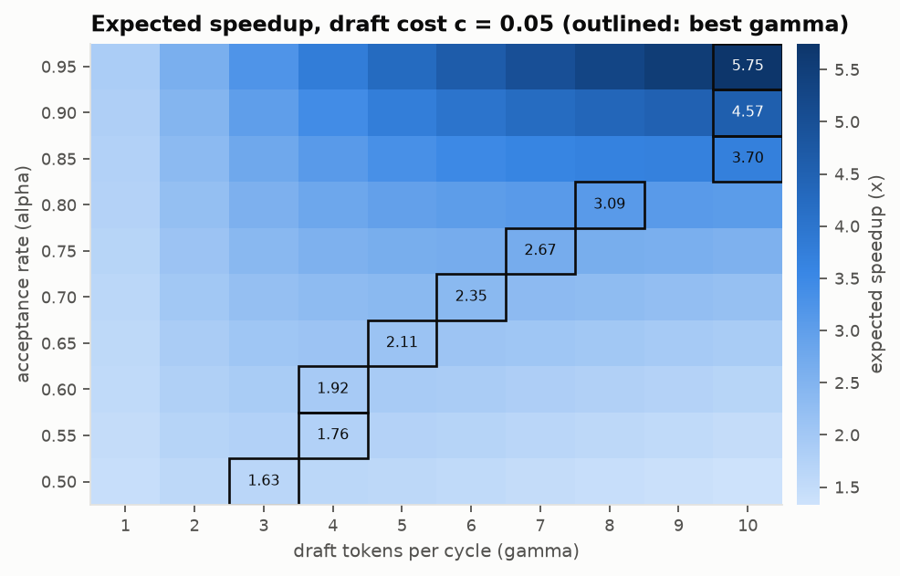
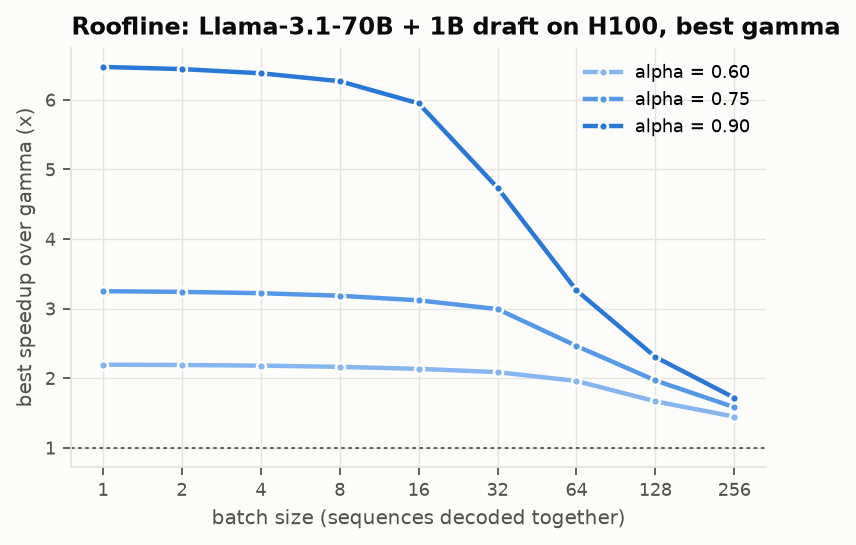

# specsim: speculative decoding, simulated and checked against real GPUs

[](https://github.com/Abhayrkhot/speculative-decoding-simulator/actions/workflows/ci.yml)

`specsim` predicts how much faster speculative decoding makes LLM inference for a
given draft/target pair, hardware and workload, and tells you which draft length
to use. It is calibrated from real measurements and validated out of sample: the
benchmark harness in [`bench/`](bench/) runs a real draft/target pair on a GPU,
and `specsim validate` predicts every measured speedup from parameters it never
fitted to those speedups.

<!-- GPU_HEADLINE -->

## How speculative decoding works, and what the simulator models

Autoregressive decoding with a large *target* model is memory-bound: each token
costs one full forward pass, and that pass costs about the same whether it scores
one token or a handful. Speculative decoding (Leviathan et al., 2023; Chen et al.,
2023) exploits this:

1. A small **draft** model proposes `gamma` tokens, one at a time:
   `gamma * t_draft(1)`.
2. The target scores all of them in **one** forward pass: `t_target(gamma + 1)`.
3. Drafts are accepted left to right until the first rejection. The same target
   pass also yields one more token: the corrected token at the rejection, or a
   bonus token if every draft was accepted. So a cycle emits `A + 1` tokens,
   where `A` is the number of accepted drafts.

With temperature > 0, acceptance uses rejection sampling (accept `x` with
probability `min(1, p(x)/q(x))`, on rejection resample from `norm(max(0, p - q))`),
which makes the output distribution *exactly* the target's. With per-position
acceptance probabilities `alpha_i`, the expected speedup is

```
            E[A + 1] * t_target(1)                    E[A + 1] = 1 + sum_i prod_{j<=i} alpha_j
speedup = ---------------------------------------
          gamma * t_draft(1) + t_target(gamma + 1)
```

which for i.i.d. acceptance and constant latency reduces to Leviathan et al.'s
`(1 - alpha^(gamma+1)) / ((1 - alpha)(gamma*c + 1))`, with `c = t_draft / t_target`.

| Component | Options |
|---|---|
| Latency | `ConstantLatency` (the paper's assumption), `LinearLatency` (fitted from a GPU profile: fixed overhead + per-token cost), `RooflineLatency` (weights + KV-cache bytes vs FLOPs, with batch size and hardware presets) |
| Acceptance | `IIDAcceptance(alpha)`, `PositionalAcceptance` (one `alpha` per draft position, estimated from real traces) |
| Engine | Closed form, vectorised Monte Carlo with 95% confidence intervals, and exact rejection sampling on a toy language model |

## Install

```bash
pip install -e ".[plot]"     # simulator + figures
pip install -e ".[dev]"      # + tests, lint, type checking
pip install -e ".[bench]"    # + torch/transformers for GPU benchmarks
```

Python 3.10+. The core depends only on NumPy.

## Usage

```console
$ specsim simulate --alpha 0.8 --gamma 4 --c 0.05 --seed 0
speedup            2.789x  (95% CI 2.783-2.796)
analytic speedup   2.801x  (infinite-horizon closed form)
per-generation     p5 2.545x  p95 3.051x
tokens per cycle   3.342
acceptance rate    0.800  (accepted / verified)
draft efficiency   0.591  (accepted / drafted)
target calls saved 70.1%

$ specsim optimal-gamma --alpha 0.6,0.7,0.8,0.9 --c 0.05
alpha  best_gamma  speedup
0.600           4    1.921
0.700           6    2.353
0.800           8    3.092
0.900          13    4.674
```

Latency can be given as a cost ratio (`--c`), measured times
(`--target-ms 25 --draft-ms 3`), or a roofline model with batch size:

```bash
specsim optimal-gamma --alpha 0.8 --roofline llama-3.1-70b llama-3.2-1b --gpu h100-sxm --batch 32
specsim sweep --alpha 0.5:0.95:0.05 --gamma 1:10 --c 0.05 --plot heatmap.png
specsim calibrate results/run.json        # fitted latency + acceptance per task
specsim validate  results/run.json --plot validation.png
specsim lossless-check                    # statistical test of rejection sampling
```

From Python:

```python
from specsim import LinearLatency, PositionalAcceptance, optimal_gamma, simulate

lat = LinearLatency(target_fixed_s=0.025, target_per_token_s=0.0002, draft_fixed_s=0.004)
acc = PositionalAcceptance.from_traces(cycles)  # [(k, n_accepted), ...] from a real run
gamma, speedup = optimal_gamma(acc, lat)
result = simulate(acc, gamma, lat, tokens=256, trials=2000, seed=0)
print(result.speedup, result.speedup_ci95)
```

## Results

### 1. The simulator agrees with theory

Monte Carlo converges to the closed form (tested to within 1%). At 256 tokens the
confidence intervals are narrower than the markers.



The exact rejection sampler passes a chi-square test against the target's exact
token distribution at every position and across cycle boundaries (200k sequences,
all Bonferroni-corrected p > 0.001). Its empirical acceptance rate, 0.6798, matches
the theoretical `1 - TV(p, q)` averaged over visited contexts, 0.6798. A
deliberately broken variant that resamples from `p` instead of `max(0, p - q)`
fails the same test (p < 1e-10), so the test has the power to catch the most
common implementation bug.

### 2. Where speculative decoding pays off

Speedup is steep in the acceptance rate, and the best draft length grows with it.
Compared with `gamma = 1`, the best `gamma` is worth 1.14x at `alpha = 0.5` and
3.1x at `alpha = 0.95`:



Speculation trades spare compute for fewer sequential steps, so the benefit
shrinks as batching makes decoding compute-bound. In the roofline model, a 70B
target with a 1B draft on H100 at `alpha = 0.8` goes from 3.9x (`gamma = 11`) at
batch 1, to 3.5x (`gamma = 7`) at batch 32, to 1.6x (`gamma = 1`) at batch 256:



<!-- GPU_RESULTS -->

## Reproducing the GPU benchmark

```bash
pip install -e ".[bench]"
python bench/spec_bench.py --draft Qwen/Qwen2.5-0.5B-Instruct \
    --target Qwen/Qwen2.5-7B-Instruct --out results/run.json --hf-reference
python bench/spec_bench.py ... --cuda-graphs        # static KV cache + CUDA graphs
specsim validate results/run.json --plot docs/validation.png
python scripts/make_figures.py results/*.json       # regenerate every figure
```

[`bench/explorer.sbatch`](bench/explorer.sbatch) is the Slurm job used on
Northeastern's Explorer cluster:

```bash
VENV=env126 sbatch bench/explorer.sbatch                                   # 7B, eager
VENV=env126 TARGET=Qwen/Qwen2.5-32B-Instruct TAG=0.5b_32b_graphs \
    BENCH_FLAGS=--cuda-graphs GAMMAS=1,2,3,4,6,8 sbatch bench/explorer.sbatch
```

The torch wheel must match the node's driver: Explorer's driver 545 needs a
`cu12x` build, and a newer wheel silently falls back to CPU. The harness refuses
to run without CUDA unless you pass `--allow-cpu`.

How the harness works:

- It runs its own speculative decoding loop with KV-cache rollback, so it can
  record per-cycle acceptance. Plain decoding goes through the same code path,
  so the baseline is apples-to-apples.
- `--cuda-graphs` gives **both** models a static KV cache and
  `torch.compile(mode="reduce-overhead")`, with one CUDA graph per decode shape.
  Rollback only moves the write position; stale slots are masked out.
- Every greedy speculative output is compared token-for-token with the
  target-only output.
- Sanity check: with the same model as draft and target, acceptance must be
  100% and greedy output identical (verified on CPU and on H200 in both modes).

## Limitations

- Batch size 1 on the GPU side. Batched serving changes the latency model; the
  roofline model covers this, but it is not validated against measurements.
- Acceptance is assumed independent of `gamma` and of the generation step. It
  depends on the draft position, which is modelled.
- Single-sequence drafting only. Tree drafting (SpecInfer, Medusa, EAGLE) would
  need a different acceptance model.
- The linear latency model is fitted at one context length; KV-cache growth over
  very long generations is not modelled.

## Project layout

```
src/specsim/
  analytic.py      closed-form expectations, optimal gamma
  simulate.py      vectorised Monte Carlo with confidence intervals
  latency.py       constant / linear / roofline latency models, hardware presets
  acceptance.py    i.i.d. and per-position acceptance, estimation from traces
  sampling.py      exact rejection sampling on a toy LM, losslessness test
  calibrate.py     fit from benchmark JSON, out-of-sample validation
  plots.py         figures
  cli.py           `specsim` command
bench/             GPU benchmark harness and Slurm job
scripts/           figure generation
tests/             pytest + hypothesis suite
```

## Development

```bash
pip install -e ".[dev]"
ruff check . && ruff format --check . && mypy && pytest --cov
```

## References

- Y. Leviathan, M. Kalman, Y. Matias. *Fast Inference from Transformers via
  Speculative Decoding.* ICML 2023. [arXiv:2211.17192](https://arxiv.org/abs/2211.17192)
- C. Chen, S. Borgeaud, G. Irving, J.-B. Lespiau, L. Sifre, J. Jumper.
  *Accelerating Large Language Model Decoding with Speculative Sampling.* 2023.
  [arXiv:2302.01318](https://arxiv.org/abs/2302.01318)

## License

MIT
